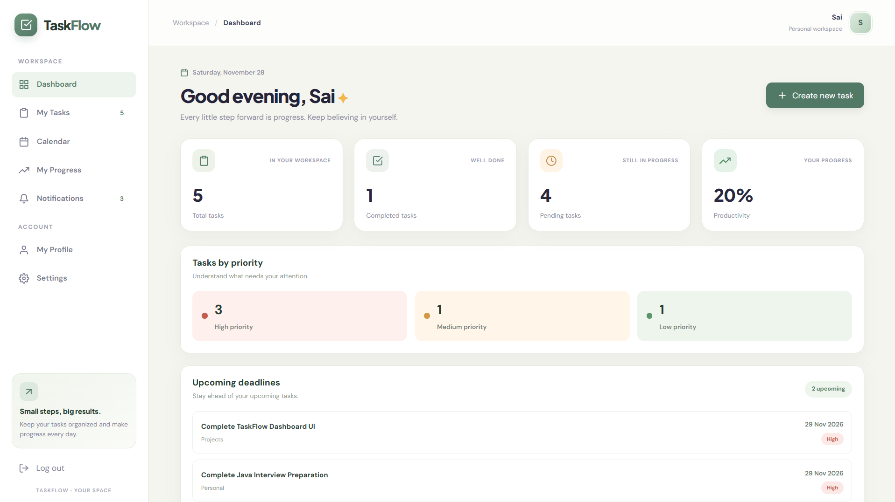
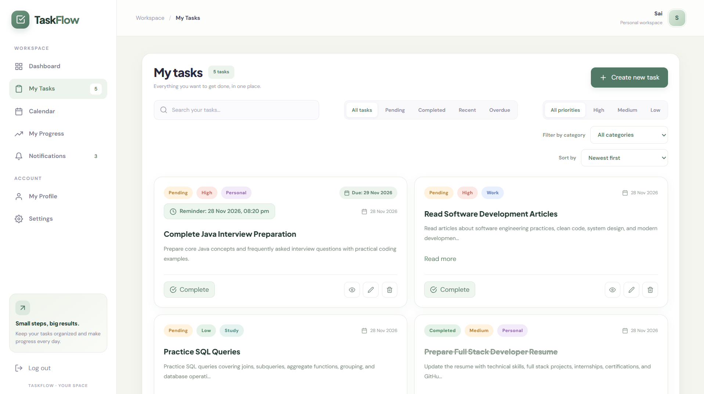
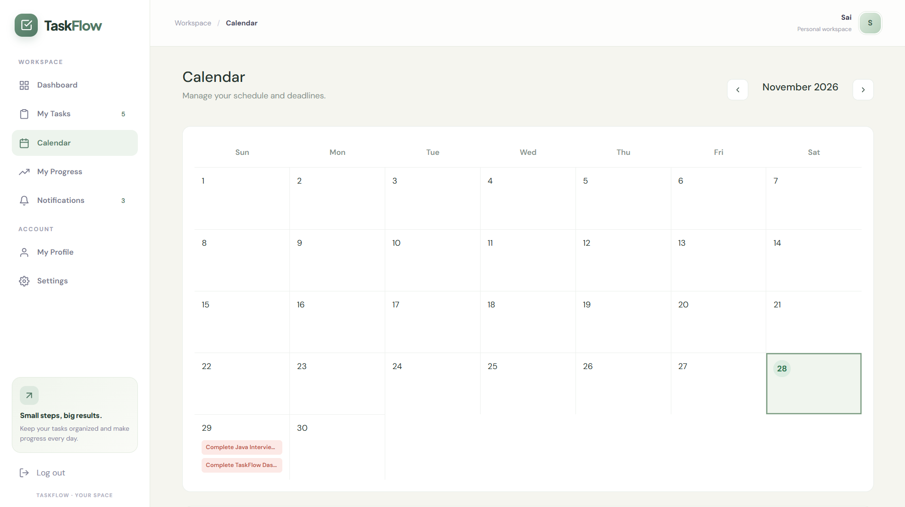
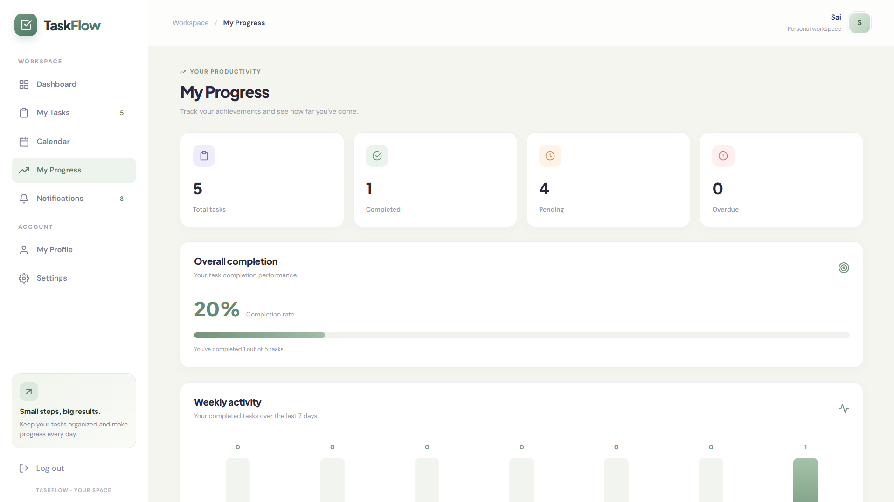
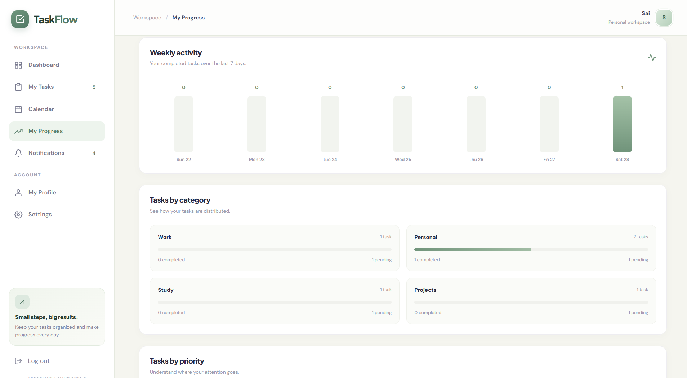
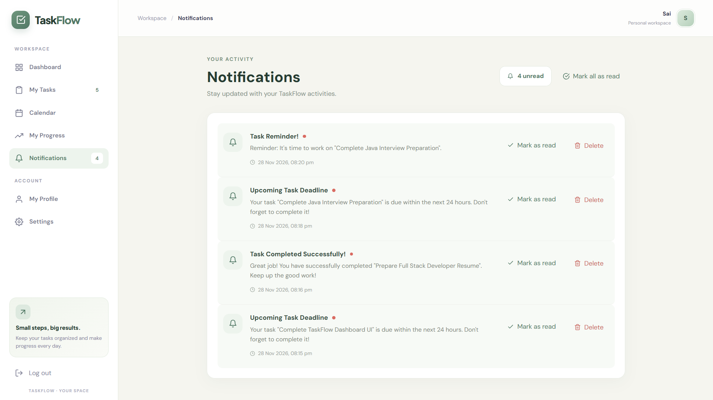
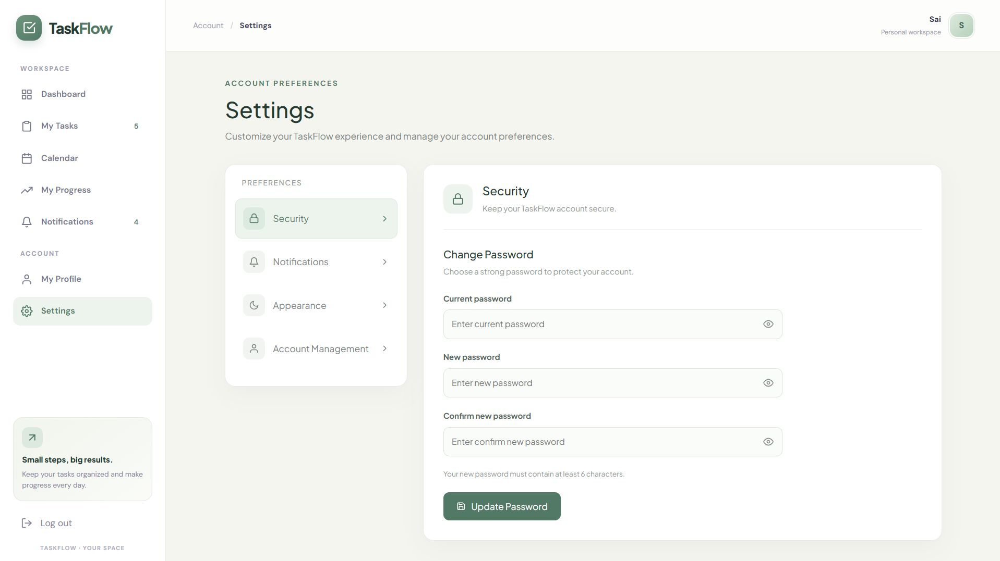
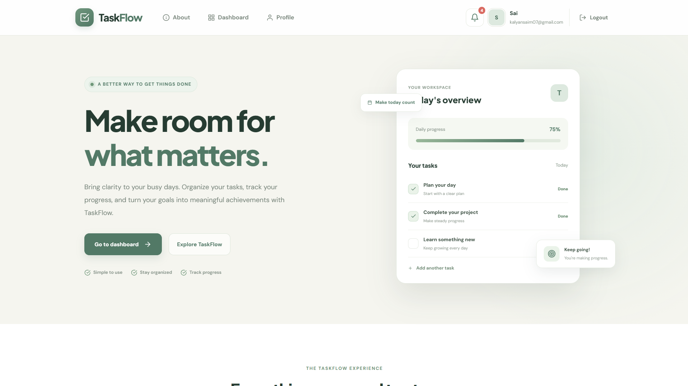

# 🚀 TaskFlow – Smart Task Management Application

A modern, responsive, and feature-rich full-stack task management application designed to help users organize tasks, manage priorities, track productivity, and stay on top of their daily activities.

🔗 **Live Application:** https://taskflow-pilot.netlify.app/  
🔗 **Backend API:** https://taskflow-st9l.onrender.com  
🔗 **GitHub Repository:** https://github.com/Kalyansai78/TaskFlow

---

## 📌 About the Project

TaskFlow is a full-stack task management application built to provide users with a simple and organized way to manage their daily tasks and improve productivity.

The application allows users to securely create accounts, manage personal tasks, organize activities into categories, set priorities, schedule reminders, and monitor their progress through an intuitive dashboard.

TaskFlow also integrates email verification, password recovery, automated task reminders, and in-app notifications to provide a complete task management experience.

The project focuses on secure authentication, responsive UI design, efficient task management, real-time user interactions, and reliable backend functionality.

---

## ✨ Features

### 🔐 Authentication & Account Management
- User registration and login
- Email verification using OTP
- Secure password hashing
- JWT-based authentication
- Forgot password functionality
- Password reset using OTP
- Protected routes
- User profile management
- Account settings

### 📝 Task Management
- Create new tasks
- Edit existing tasks
- Delete unwanted tasks
- Mark tasks as completed or pending
- Add task descriptions
- Assign task priorities
- Organize tasks using categories
- Set due dates
- Add subtasks and track their completion

### ⏰ Reminders & Notifications
- Schedule task reminders
- Automated reminder scheduling
- Due-soon and overdue notifications
- In-app notification management
- Email notifications using Resend
- Notification preferences

### 📊 Dashboard & Productivity
- Personalized dashboard
- Task progress tracking
- Task completion statistics
- Calendar-based task management
- Productivity overview

### ⚙️ User Experience
- Responsive design for desktop and mobile
- Light and dark themes
- Search and task organization
- Interactive UI components
- Toast notifications for success and error messages
- User-specific settings and preferences

---

## 📸 Screenshots

### 🏠 Dashboard


### 📝 My Tasks


### 📅 Calendar


### 📊 Progress Tracking


### 📊 Progress Tracking


### 🔔 Notifications


### 👤 User Profile & Settings


### 🔐 Authentication


---

## 🛠️ Tech Stack

### Frontend
- **React.js** — Building interactive user interfaces
- **Vite** — Frontend development and build tool
- **JavaScript (ES6+)** — Application logic
- **HTML5** — Application structure
- **CSS3** — Styling and responsive layouts
- **React Router** — Client-side navigation
- **Redux** — State management
- **Axios** — API communication
- **React Toastify** — User notifications

### Backend
- **Node.js** — JavaScript runtime
- **Express.js** — REST API development
- **MongoDB** — NoSQL database
- **Mongoose** — Database modeling
- **JWT** — Authentication
- **Bcrypt** — Password hashing
- **Resend** — Email delivery service
- **Node Schedule** — Task reminder scheduling

### Deployment & Tools
- **Git & GitHub** — Version control
- **Netlify** — Frontend deployment
- **Render** — Backend deployment
- **MongoDB Atlas** — Cloud database hosting
- **Resend** — Transactional email delivery

---

## 🏗️ Application Architecture

TaskFlow follows a client-server architecture.

1. The React frontend provides the user interface and interacts with the backend through HTTP requests.
2. The Express backend handles authentication, task operations, and application logic.
3. MongoDB stores user accounts, tasks, notifications, and related application data.
4. Resend handles transactional email delivery.
5. The notification scheduler manages scheduled task reminders.

```text
                  TASKFLOW APPLICATION

               ┌──────────────────────┐
               │    React Frontend    │
               │   React + Vite       │
               └──────────┬───────────┘
                          │
                     Axios API
                          │
               ┌──────────▼───────────┐
               │   Node.js Backend    │
               │   Express.js API     │
               └──────────┬───────────┘
                          │
              ┌───────────┼────────────┐
              │           │            │
        ┌─────▼────┐ ┌────▼─────┐ ┌────▼──────┐
        │ MongoDB  │ │  Resend  │ │ Scheduler │
        │  Atlas   │ │  Emails  │ │ Reminders │
        └──────────┘ └──────────┘ └───────────┘
```

---

## 📁 Project Structure

```text
TaskFlow/
│
├── backend/
│   ├── connection/
│   ├── controllers/
│   ├── models/
│   ├── routes/
│   ├── utils/
│   ├── index.js
│   └── package.json
│
├── frontend/
│   ├── public/
│   ├── src/
│   │   ├── api/
│   │   ├── components/
│   │   ├── store/
│   │   ├── App.jsx
│   │   ├── main.jsx
│   │   └── index.css
│   ├── package.json
│   └── vite.config.js
│
├── screenshots/
│   ├── dashboard.png
│   ├── tasks.png
│   ├── calendar.png
│   ├── progress1.png
|   ├── progress2.png
│   ├── notifications.png
│   ├── settings.png
│   └── login.png
│
└── README.md
```

---

## 🚀 Getting Started

Follow these steps to run TaskFlow locally.

### 1. Clone the Repository

```bash
git clone https://github.com/Kalyansai78/TaskFlow.git
```

### 2. Navigate to the Project

```bash
cd TaskFlow
```

### 3. Setup Backend

```bash
cd backend
npm install
```

Create a `.env` file inside the backend folder:

```env
PORT=1000
MONGODB_URI=your_mongodb_connection_string
DB_NAME=taskflow
JWT_SECRET=your_jwt_secret
FRONTEND_URL=http://localhost:5173

RESEND_API_KEY=your_resend_api_key
EMAIL_FROM=your_verified_sender_address
```

Start the backend:

```bash
npm start
```

### 4. Setup Frontend

Open another terminal:

```bash
cd TaskFlow/frontend
npm install
```

Create a `.env` file inside the frontend folder:

```env
VITE_API_URL=http://localhost:1000
```

Start the frontend:

```bash
npm run dev
```

### 5. Open the Application

Visit:

```text
http://localhost:5173
```

**Note:** Configure your MongoDB connection, JWT secret, and Resend email credentials before running the complete application. Use your own verified email sender address for production email delivery.

---

## 🌐 Deployment

TaskFlow is deployed using the following services:

| Component | Platform |
|---|---|
| Frontend | Netlify |
| Backend | Render |
| Database | MongoDB Atlas |
| Email Service | Resend |
| Source Code | GitHub |

- **Frontend:** https://taskflow-pilot.netlify.app/
- **Backend:** https://taskflow-st9l.onrender.com

---

## 🔒 Environment Variables & Security

- Sensitive credentials are stored in environment variables.
- Passwords are hashed before database storage.
- JWT tokens are used for protected API access.
- API keys and database credentials are not included in the repository.
- Environment files are excluded from version control.

Never upload your actual `.env` files or API keys to GitHub.

---

## 🔮 Future Enhancements

- Google authentication
- Collaborative workspaces and shared tasks
- Task assignment between users
- File attachments for tasks
- Advanced productivity analytics
- Recurring tasks
- Push notifications
- More advanced filtering and reporting

---

## 👨‍💻 Author

**Kalyan Sai**

- GitHub: [@Kalyansai78](https://github.com/Kalyansai78)

---

## ⭐ Support

If you find TaskFlow useful, consider giving the repository a ⭐ on GitHub!

**TaskFlow – Plan Smarter. Stay Organized. Get Things Done.**